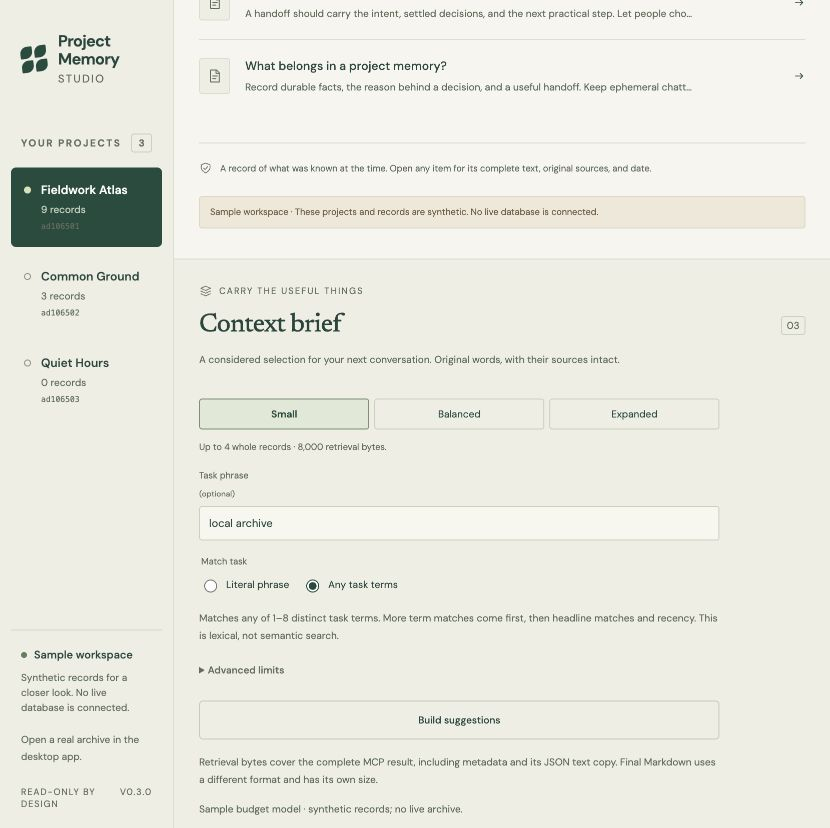

# Project Memory MCP

**Project knowledge that survives the next AI session.**

A local Rust + SQLite MCP server, a focused developer workflow pack, and an
optional desktop workspace. Remember why a decision was made, retrieve useful
context within a visible budget, and continue with evidence you can inspect.

**Toolkit v0.5.0:** the features below describe this source version. Download
matching builds from [GitHub Releases](https://github.com/CharlieJamesGwapo/project-memory-mcp/releases)
and check `--version`. The older v0.1 release has ten tools and three skills.

[Get started](docs/quickstart.md) · [Skills](docs/skills.md) ·
[Architecture](docs/architecture.md) · [API](docs/api-reference.md) ·
[Security](docs/security.md) · [Troubleshooting](docs/troubleshooting.md)

## New in v0.5.0

- [Guided setup](docs/setup.md): preview archive checks and exact client JSON while
  preserving local restrictions, without executing the server or changing settings.
- [Studio Reviews and Health](docs/studio.md): inspect full review evidence,
  supplied-head freshness and bounded memory assessments through explicit controls.
- [Memory health](docs/memory-health.md): historical snapshot counts and review
  suggestions, with complete assessments, cursors and visible byte budgets.
- [MCP resource views and prompts](docs/mcp-views.md): selected project briefs,
  first-page health and reusable workflows, with existing tool fallbacks.

The [v0.4 security policies](docs/access-policy.md), credential guards, optional
metadata audit and immutable review records remain. Discovery exposes 15 tools
by default, 16 with local deletion opt-in, and ten read tools in read-only mode.
Policy can reduce access. Existing schema-1 archives need no migration.

## What you get

| Need | Included |
|---|---|
| Resume a project | Notes, explicit decision history, handoffs, UUID isolation and original sources |
| Return useful context | Literal search or opt-in ranked terms, whole records, byte caps, matched terms and omission reasons |
| One workflow entry | `project-memory` routes to context-saving, review, agents, security, debugging and verification |
| Focused memory actions | `resume-project`, `record-decision` and `prepare-handoff` remain directly usable |
| Inspect visually | Studio project browser, search, Small/Balanced/Expanded context presets and deliberate suggestions |
| Operate safely | Read-only server mode, archive doctor, offline skill installer, consistent backups and release checks |
| Work without an AI client | Explicit archive initialization, read-only CLI projects/search/record/context and Markdown briefs |

The server is free and open source, needs no paid model API, and runs without a
hosted service. Your AI client supplies the model and any code tools or agents.
Agent workflows use the host's actual capabilities and existing permissions.

## Start here

1. Get a native server archive or compatible MCPB from
   [GitHub Releases](https://github.com/CharlieJamesGwapo/project-memory-mcp/releases).
   Prebuilt server binaries need no Rust, Node.js or separate database service.
2. Connect the executable as a local stdio MCP server. Use absolute paths and
   follow the [client setup guide](docs/quickstart.md).
3. Install the four-folder [workflow pack](docs/skills.md), then ask:

> Use project-memory to continue Atlas's authentication work with a small
> context budget. Check current code before relying on old test results.

Initialize explicitly, then inspect setup without changing client settings:

```sh
/absolute/path/project-memory-mcp --db /absolute/path/memory.sqlite init
/absolute/path/project-memory-mcp --db /absolute/path/memory.sqlite doctor
/absolute/path/project-memory-mcp --db /absolute/path/memory.sqlite print-config
```

A missing archive is normal before first use. Use explicit `init` or start
writable mode through your MCP client to create one. Append `--read-only` for inspection of an existing
archive; it exposes ten read tools. Running the binary with no subcommand
waits for the MCP handshake.

The [standalone CLI](docs/cli.md) lists project UUIDs, searches literal text,
reads complete records and prints context briefs without starting a model.
Simultaneous writable clients serialize first initialization and validate the
archive identity in one transaction; startup lock contention has a bounded retry.

To build the checked-out source:

```sh
cargo build --release --locked
./target/release/project-memory-mcp --help
```

The repository pins Rust 1.100. Windows uses `project-memory-mcp.exe`.
See [contributor setup](CONTRIBUTING.md) for prerequisites and checks.

Run `setup` for a guided local check and configuration preview, or `setup --json`
for a structured report. [Setup guide](docs/setup.md).

## Context you can account for

`search_memory` finds literal text across notes, decision rationale and handoff
sections. `get_context_bundle` selects complete records, retaining authorship,
timestamps, sources and replacement history. It reports what did not fit.
Explicit record selections either fit completely or return an error.

Opt-in `query_mode:"terms"` finds words spread across record fields. It ranks by
distinct term coverage, headline coverage, then recency across the project before
the candidate window, and reports matched terms. Literal mode remains the default.
This is deterministic lexical retrieval, not semantic search.

The default bundle cap is 16,000 serialized MCP result bytes and eight records.
Token estimates use bytes/4 and are clearly labeled. They do not measure model
billing or promise a savings percentage. [The API reference](docs/api-reference.md)
defines exactly what is counted and how compatibility text affects the budget.

## Desktop companion



Earlier browser preview of the context builder with labeled synthetic records.
v0.5 adds Reviews, Health and Guided Setup; see the [Studio guide](docs/studio.md).

[Project Memory Studio](docs/studio.md) uses Tauri + React and the same Rust
store. It opens existing archives read-only, displays full records, and composes
a selected Markdown brief. Suggested context requires an explicit Add or Replace
action; your manual selection remains under your control.

The browser preview uses labeled synthetic data. The local desktop preview is
runtime-tested on macOS Apple Silicon. Windows/Linux CI compilation is separate
from interactive OS testing; Linux desktop dependency limits are documented.

## Privacy and trust

Memory is local plaintext SQLite. Save durable project facts, not secrets.
The server has no telemetry, model API, automatic chat capture or repository
crawler. Your AI client controls which retrieved text is sent to its model.

Saved records are untrusted reference data. A stored “deploy” or “send this” note
does not authorize an action. Historical verification describes its recorded
time. UUIDs are project identifiers, not authentication. Read-only SQLite may
create WAL/SHM coordination files while preserving memory/schema contents.

The repository includes regression tests, dependency/advisory checks, redacted
source-policy checks, pinned release actions and artifact-provenance verification.
These provide scoped evidence, not a guarantee of malware absence. Read the
[security model and current warnings](docs/security.md) and
[backup/restore guide](docs/data-safety.md).

## Complete guide

| Guide | Contents |
|---|---|
| [Quickstart](docs/quickstart.md) | Native/source install, Claude Desktop, Cursor, Codex, defaults and first use |
| [Terminal workflows](docs/cli.md) | Explicit init, read-only projects/search/record/context and honest output budgets |
| [Retrieval evaluation](docs/retrieval-evaluation.md) | Real-MCP synthetic coverage, byte and provenance checks you can reproduce |
| [Skill evaluation](docs/skill-evaluation.md) | Versioned behavioral fixtures, observed results and evaluation limits |
| [Skills](docs/skills.md) | One entry workflow, offline installation, customization, upgrade and restore |
| [Workflows](docs/workflows.md) | Practical resume, budget, review, agents, decisions, handoff and audit examples |
| [Architecture](docs/architecture.md) | Components, data flow, schema, transactions, retrieval and desktop boundaries |
| [API](docs/api-reference.md) | All 16 supported MCP tools, conditional access, inputs, byte budgets, pagination, errors and CLI commands |
| [Studio](docs/studio.md) | Desktop setup, search, suggestions and Markdown briefs |
| [Data safety](docs/data-safety.md) | Consistent backup, restore, privacy, history and deletion |
| [Security](docs/security.md) | Threat model, actual audit limits, upstream warnings and release integrity |
| [Troubleshooting](docs/troubleshooting.md) | Common setup, query, budget, SQLite and desktop problems |
| [Publishing](docs/publishing.md) | Versioned builds, standard-library MCPB packing, provenance and MCP Registry |
| [Release evidence](https://github.com/CharlieJamesGwapo/project-memory-mcp/blob/main/docs/releases/0.4.0-verification.md) | v0.4.0 source, checks, public download hashes, provenance and verification limits |
| [Contributing](CONTRIBUTING.md) | Tests, platform checks and contribution expectations |
| [Changelog](CHANGELOG.md) | Changes and compatibility |

## Roadmap

Next priorities are user feedback on retrieval quality, broader native UI
testing, signed/notarized desktop distribution, and resolving the upstream Linux
desktop dependency path. Semantic retrieval and team synchronization need a
separate privacy, cost and migration design. Suggestions and reproducible issues
are welcome on [GitHub](https://github.com/CharlieJamesGwapo/project-memory-mcp/issues).

MIT licensed. See [LICENSE](LICENSE). Vulnerability reporting: [SECURITY.md](SECURITY.md).

MCP Registry identity: `mcp-name: io.github.CharlieJamesGwapo/project-memory`.
