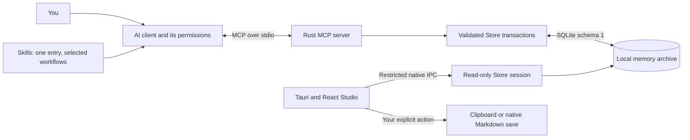
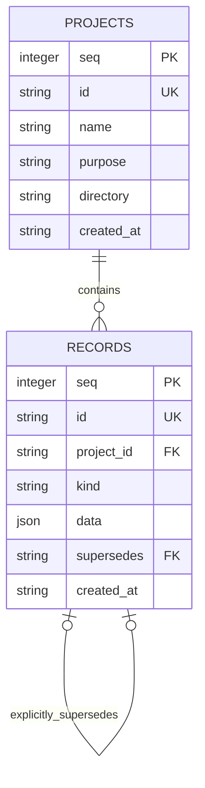

# Architecture

Project Memory has three product layers sharing one local record model:

The AI client supplies the model, code tools and any agents. The MCP server
supplies memory operations. Skills guide the client; installing a skill does
not create a model service, run a background agent, or grant permissions.

## Rust server

| Area | Responsibility |
|---|---|
| `src/main.rs` | CLI, database selection, read-only mode, doctor/config output, stdio lifecycle |
| `src/cli.rs` | Explicit setup and read-only terminal commands; JSON/Markdown output without a model |
| `src/server.rs` | Typed MCP tools, annotations, blocking-worker dispatch and read-only tool inventory |
| `src/input.rs` | Strict schemas, field/size checks and canonical project/record IDs |
| `src/store.rs` | SQLite identity, schema 1, transactions, immutable records and project isolation |
| `src/store/retrieval.rs` | Cross-kind literal search, full-record context bundles and diagnostics |
| `src/store/studio.rs` | Studio counts and filtered pages; not extra public MCP tools |
| `src/output.rs` | MCP result shapes and serialized byte accounting |
| `src/export.rs` | Complete-record Markdown export with safe code fences |

Connections use parameterized SQL. Each operation runs in a transaction.
Mutations use an immediate transaction; read operations use a deferred snapshot.
Writable startup validates identity and creates an empty schema within one
serialized writer transaction, rechecking after a concurrent initializer. WAL
configuration follows outside the transaction, sharing a five-second SQLite
contention budget with initialization. Only BUSY/LOCKED setup contention is
retried; record writes are not automatically replayed.
Writes are not idempotent: after a connection failure, inspect history before
retrying a save. UUIDs separate projects; they are not authentication.

## Storage and history

Records are notes, decisions or handoffs. Authorship and sources live in their
data. Decisions change through an explicit successor; independent conflicting
decisions remain visible. Handoffs append immutable revisions. SQLite foreign
keys prevent cross-project replacement. `application_id` PMCP and `user_version`
1 identify supported archives; they are not signatures or a trust boundary.

Normal writable opening initializes a new empty archive. Read-only opening
requires an existing supported regular file, performs no migration, and applies
SQLite read-only/query-only enforcement. It never adopts a foreign database.
SQLite can still maintain WAL/SHM coordination files; read-only refers to the
archive's records/schema and prevents creation of a missing main database.

## Retrieval

Search matches literal human-facing text. It uses no embeddings, paid API,
semantic inference or automatic source indexing. A query result is a preview;
`get_record` returns the complete record. Scoped snapshot cursors exclude later
inserts and future successor references. Deletions can still remove entries.

Context bundles keep whole records. Automatic selection follows a documented
order or literal task query and considers at most 200 candidates. The result
reports omissions instead of silently shortening evidence. Explicit selections
are atomic: the full set fits, or the request fails. [API details](api-reference.md)
explain canonical result bytes, compatibility text and estimated token counts.

Optional bundle terms mode ranks decoded human text by distinct query coverage,
headline coverage and insertion order before limiting the candidate window.
Bound SQL placeholders carry every query value. It requires no persistent index
or schema migration, so both writable MCP and existing read-only Studio sessions
use the same archive. It is lexical selection rather than semantic inference.
Studio uses a committed alphanumeric range table generated from the pinned Rust
toolchain. Its native test compares every Unicode scalar, preventing differences
between a webview's older Unicode database and the server's tokenizer.

Explicit terminal commands reuse the same Store operations. Only `init` opens
writable mode; inspection opens an existing archive read-only. Printed context
JSON/Markdown is a separate representation from the measured canonical MCP result.

## Desktop boundary

`apps/studio` contains React/Vite and Tauri. A native session owns the read-only
Store and session UUID. A successful file change replaces that session; stale
requests fail. React also invalidates outstanding results when the current
project or session changes. A failed open retains the previous native session.

Native IPC whitelists read operations. Clipboard output needs an explicit
action. Markdown destinations come from the native save dialog, not a frontend
path. Database files, symlink destinations and non-Markdown exports are refused.
Saved text is displayed as text. Fonts and assets are bundled with a local CSP.
Browser previews use labeled synthetic data, not a live database connection.

## Build and distribution

The native server embeds SQLite and runs independently of Rust after building.
The desktop uses each OS's webview. MCPB is a ZIP of a manifest, platform
binaries and inspectable supporting files. Archives exclude databases,
credentials, development caches and dependencies. A versioned hash identifies
an artifact; it does not establish that every dependency is harmless.

See [security](security.md), [publishing](publishing.md), and
[contributor instructions](../CONTRIBUTING.md) for checks and release boundaries.
